<!-- Master text of the semester report. Transcribed verbatim from figures/report_diagrams/build.js (which generated the 2026-10-31 .docx) on 2026-11-23. Edits from here on are made in this file. -->

<!-- docx properties: title "NeuroVision-X Final Project Report"; creator "Amish Yadav"; description "Final project report for NeuroVision-X". Footer: page number (lower-roman for front matter, decimal from Chapter 1). -->

<!-- Title page (centred in the .docx) -->

**FINAL PROJECT REPORT**

**NeuroVision-X**

Three-Dimensional Brain Tumour Segmentation with a Distribution-Free Error Bound and a Refusal Gate: Where It Holds, Where It Breaks, and What a New Site Needs

*Submitted by*

**Amish Yadav**

Course Project, Semester 2026

November 2026

*Research software. Not a medical device. Not for clinical use.*

<!-- pagebreak -->

<!-- FRONT MATTER (review row R12, MasterPlan W1.3). Order and wording must follow the college template,
which the author supplies. Every [AUTHOR: …] marker is filled by the author, never by an assistant. -->

# Certificate

This is to certify that the project report entitled **"NeuroVision-X: Three-Dimensional Brain Tumour Segmentation with a Distribution-Free Error Bound and a Refusal Gate"** is a record of work carried out by **Amish Yadav** [AUTHOR: roll number] in partial fulfilment of the requirements of [AUTHOR: course name and code], [AUTHOR: department, institution], during the semester [AUTHOR: semester and year], under my supervision.

[AUTHOR: supervisor name, designation, signature, date] · [AUTHOR: head of department, signature, date]

<!-- pagebreak -->

# Declaration of Originality

I declare that this report is my own work, that it has not been submitted for any other degree or course, and that all sources are acknowledged in the text and in the References. Code and text drafted with AI assistance are described in the Statement on the Use of AI Assistance below; I have checked every number in this report against the project's results record.

[AUTHOR: signature, date]

<!-- pagebreak -->

# Acknowledgement

[AUTHOR: written by the author — supervisor, department, anyone who helped. Suggested facts to include: Kaggle for GPU time; the BraTS, BraTS-Africa, BraTS-PEDs and RSNA-MICCAI organisers and the patients whose de-identified scans made this work possible.]

<!-- pagebreak -->

# Statement on the Use of AI Assistance

This project made extensive use of AI assistance, and this statement says where.

- **Code.** Most of the source code, tests and analysis scripts were written by an AI coding assistant (Anthropic's Claude, used through Claude Code) from specifications. The author decided the research questions, the experiments, the pre-registered decision rules and what each module must do; the assistant implemented, tested and reviewed modules one at a time.
- **Text.** Drafts of this report, the pre-registration documents and the results notes were written with the assistant. Sections 1 (Introduction) and 4.8 (Conformal risk control) were rewritten by the author in their own words. [AUTHOR: confirm, or list the sections you rewrote.]
- **Verification.** Every number in this report is traced to a committed result file by an automated audit script (zero mismatches required before submission), and every reference was checked against its source. [AUTHOR: state what you verified yourself, e.g. which sections you can explain without notes.]
- **Responsibility.** The author takes responsibility for the content, including any error the assistant introduced and the author did not catch.

<!-- pagebreak -->

# Abstract

Deep-learning models for brain tumour segmentation are usually validated on clean, curated data and reported as a single accuracy number. In use they meet scans from other hospitals, scanners and patient populations, where they can fail without any warning. This project, NeuroVision-X, builds a complete three-dimensional brain tumour segmentation system on multi-modal MRI (T1, T1CE, T2 and FLAIR) and then measures, under pre-registered rules, how far its reliability machinery can be trusted when the data changes.

The segmentation model is a dual encoder, a 3D convolutional network and a Swin Transformer, joined by adaptive gated cross-attention fusion at four scales, a U-Net decoder and three output heads (34.9 million parameters). It was trained on a frozen random split of the BraTS 2021 training set (875 / 187 / 189 cases) and tested on two external cohorts, BraTS-Africa (60 cases) and paediatric BraTS (99 cases), and on real clinical DICOM of 40 patients. Around the model sits a full clinical pipeline: DICOM ingest, co-registration to the SRI24 atlas, skull stripping, label-free input quality control, a quality-control model, conformal risk control, and a refusal gate that returns PROCEED, CAUTION or REFUSE, served through a web application with a 3D viewer and an atlas-based anatomical report.

Against a U-Net trained with the same recipe, the model improves enhancing-tumour Dice by +0.0267 (95% CI 0.0166 to 0.0393, Holm-adjusted p = 1.4 × 10⁻²¹, n = 189), and the result replicated at a second seed pair. About 40% of that margin comes from two test cases with no enhancing tumour in the reference; on the 184 cases that have one, the gain is +0.0165. A width-matched control suggests that most of the gain comes from the architecture rather than the parameter count, but those arms are single-seed, so the split is descriptive. A properly configured nnU-Net beats the model (0.8879 vs 0.8709), so the architecture claim was withdrawn. The project's founding hypothesis, that conditioning the fusion gate on branch disagreement produces the gain, returned a pre-registered null. A distribution-free bound on the fraction of tumour the mask misses holds in distribution in all six tested cells, for the matched U-Net, the proposed model and nnU-Net. Under deployment change it breaks in 7 of 12 shifted cells (5 of 12 for nnU-Net): modestly on BraTS-Africa (whole tumour about 1.1 times the nominal level), and outright on paediatric tumour core (up to 11.5 times), where the reference labels define the core differently and no threshold repairs it for any model. End to end, the pipeline returns a usable mask for 85%, 78% and 24% of in-distribution, African and paediatric studies, with silent failure rates of 4.2%, 18.3% and 49.5%; the refusal gate cannot see cohort-level shift. A counterfactual analysis shows that 10 to 40 labelled local cases restore the bound at a new site, except for paediatric tumour core, which cross-fitted fine-tuning recovers.

**Keywords:** brain tumour segmentation, BraTS, Swin Transformer, conformal risk control, distribution shift, refusal gate, pre-registration, clinical imaging pipeline.

<!-- pagebreak -->

# Table of Contents

<!-- TOC generated at build time -->

<!-- pagebreak -->

# List of Figures

<!-- TOC generated at build time -->

<!-- pagebreak -->

# List of Tables

<!-- TOC generated at build time -->

<!-- pagebreak -->

# List of Abbreviations

**Table 1.** Abbreviations used in this report.

| Abbreviation | Meaning |
| --- | --- |
| BraTS | Brain Tumor Segmentation challenge and dataset |
| SSA / PED | BraTS-Africa (sub-Saharan Africa) cohort / paediatric BraTS cohort |
| ET / TC / WT | Enhancing tumour / tumour core / whole tumour sub-regions |
| NCR, ED | Necrotic and non-enhancing tumour core; peritumoural oedema |
| CNN | Convolutional neural network |
| Swin | Shifted-window vision Transformer |
| CRC | Conformal risk control |
| CI | Confidence interval (95%, paired bootstrap unless stated) |
| HD95 | 95th-percentile Hausdorff distance (mm) |
| QC | Quality control |
| OOD | Out of distribution |
| TTA | Test-time augmentation |
| AMP | Automatic mixed precision |
| AUROC | Area under the receiver operating characteristic curve |
| DICOM, DICOM-SEG | Digital Imaging and Communications in Medicine; its segmentation object |
| SRI24 | SRI24 multichannel brain atlas |
| GPU-h | GPU hours (Kaggle Tesla T4) |

<!-- pagebreak -->

# 1. Introduction

## 1.1 Background

Gliomas are the most common primary malignant brain tumours in adults. Their treatment, from surgical planning to radiotherapy and follow-up, depends on knowing where the tumour is and how large each of its parts is. On magnetic resonance imaging (MRI) a glioma is not one object but three nested sub-regions: the **enhancing tumour (ET)**, which lights up after contrast injection on T1CE; the **tumour core (TC)**, which adds necrotic and non-enhancing tissue; and the **whole tumour (WT)**, which adds the surrounding oedema visible on FLAIR. Outlining these regions by hand in three dimensions takes an expert a long time and different experts disagree, which is why automatic segmentation has been studied for more than a decade.

The Brain Tumor Segmentation (BraTS) challenge supplies the standard benchmark: skull-stripped, co-registered multi-modal MRI with expert labels. Modern deep networks reach Dice overlaps above 0.9 on whole tumour. But these numbers are measured on data that looks like the training data. Real hospitals use different scanners, field strengths, slice thicknesses and patient populations, and a network that scores well on a benchmark can return a confident and wrong mask on such a scan with nothing in the system raising an alarm.

## 1.2 Problem statement

Most published segmentation work reports one accuracy number on a held-out split and stops. That number says nothing about three questions a deployment actually depends on:

1. How large is the error on a particular new study, and can that error be bounded with a guarantee rather than an estimate?
2. Does that guarantee still hold when the new study comes from a different site or a different population?
3. Can the system recognise the studies it should not answer, and refuse them, instead of failing silently?

This project builds a full brain tumour segmentation system and answers those questions by measurement, on one in-distribution test set, two external cohorts at increasing distance from the training data, and real clinical DICOM.

## 1.3 Motivation and how the project's aim changed

The project started with an architectural idea: a dual-encoder network whose fusion gate reads how much its two branches disagree at each voxel, expected to give better calibrated and better bounded segmentations. Every claim was pre-registered, that is, written down with its decision rule before the data existed. The evidence then reshaped the project three times (Figure 1). The model turned out to be more accurate but not more reliable; its claimed novelty was not what produced the gain; and in the end a properly configured nnU-Net beat it. Instead of hiding these results, the project rebuilt the reliability question as a measurable property of a wrapper around *any* model. The final thesis is:

> *A conformal bound and a refusal gate around a tumour segmentation model hold where the data are exchangeable with the calibration set. Under acquisition and population change the bound degrades and a stronger model shrinks the damage; where the label definition changes it fails outright for every model and no threshold repairs it. The gate sees bad masks, not changed cohorts. We measure each failure, and what local data restores.*

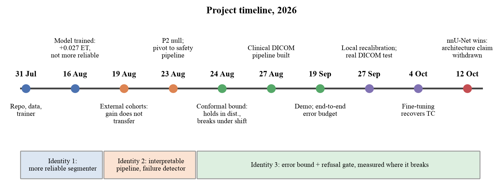

**Figure 1.** Project timeline and its three identities. Each change was forced by a measured result.

## 1.4 Objectives

1. Build and train a dual-encoder (CNN + Swin Transformer) segmentation network with gated cross-attention fusion, and compare it fairly against a matched U-Net, a width-matched capacity control, an ablation of its key mechanism, and nnU-Net.
2. Evaluate it in distribution and on two external cohorts (BraTS-Africa and paediatric BraTS) with paired statistics and multiple-comparison correction.
3. Wrap it in conformal risk control to obtain a distribution-free bound on the fraction of tumour the mask misses, and measure where that bound holds and where it breaks.
4. Build a clinical pipeline from a raw DICOM study to a gated result (PROCEED / CAUTION / REFUSE), with input quality control, a quality-control model and an end-to-end error budget.
5. Determine what a new site would need to restore the bound: local recalibration data, fine-tuning, or both.
6. Deliver a usable web application with a 3D viewer and an atlas-based anatomical report, and document every result, positive or negative.

## 1.5 Scope

The project is a college course project (semester demo and report, November 2026) that continues as a capstone (summer 2027) and a journal submission to MELBA. It is research software. It is **not** a medical device, it is not deployed, and nothing it outputs is intended for diagnosis or treatment. The guarantee it studies is an average over studies in distribution, never a promise about an individual patient.

## 1.6 Contributions

- A controlled study of what a dual-encoder fusion architecture does and does not buy, including a width-matched capacity control, a parameter-matched ablation of the founding mechanism, a two-seed noise floor and a full-recipe nnU-Net comparison, all pre-registered.
- A measurement of conformal risk control on three models under two kinds of deployment change (adult glioma → African adult glioma, a change of acquisition and population; → paediatric tumours, which also changes what the tumour-core label means), separating the label-definition failure from the imaging shift. With three cohorts, no ordering by shift size is claimed.
- An end-to-end DICOM-in pipeline with a refusal gate, and an honest error budget of what it returns per cohort, including its silent-failure rate.
- A counterfactual estimate of how many labelled local cases restore the bound, a sub-region shown before the run to be unrecoverable by recalibration, and evidence that fine-tuning recovers it.
- A reproducible, tested code base (about 2,670 automated CPU tests), fourteen pre-registration documents with their amendments, and a public record of every negative result.

## 1.7 Organisation of the report

Chapter 2 reviews related work. Chapter 3 describes the data. Chapter 4 gives the methodology: preprocessing, the model, baselines, training, evaluation and the reliability methods. Chapter 5 describes the system design and implementation. Chapter 6 presents the results and Chapter 7 discusses them. Chapter 8 lists limitations, Chapter 9 the engineering lessons, and Chapter 10 concludes with future work.

<!-- pagebreak -->

# 2. Literature Review

## 2.1 Brain tumour segmentation

The BraTS benchmark (Menze et al., 2015; Baid et al., 2021) established multi-modal MRI glioma segmentation as a standard task. The U-Net (Ronneberger et al., 2015) and its 3D form (Çiçek et al., 2016) remain the backbone of most solutions. nnU-Net (Isensee et al., 2021) showed that a carefully self-configuring U-Net, with a long training schedule, heavy augmentation and a large patch, wins most medical segmentation benchmarks without architectural novelty. Its 2024 follow-up, *nnU-Net Revisited*, found that many claimed architectural gains, including those of transformer hybrids such as SwinUNETR, disappear against a properly configured CNN baseline. This project's Gate A experiment reproduces exactly that finding for its own model.

## 2.2 CNN–Transformer hybrids and fusion

Transformers capture long-range context through self-attention; the Swin Transformer (Liu et al., 2021) makes this affordable through shifted local windows, and SwinUNETR (Hatamizadeh et al., 2022) applies it to 3D brain tumour segmentation. Hybrid models combine a CNN for local texture with a transformer for global context and merge the two streams by concatenation, addition or gated attention. Gated fusion, where a learned gate weights one stream against the other, is published territory. The novelty this project proposed was narrower: a gate that reads an explicit per-voxel ambiguity signal (branch disagreement and branch entropy) rather than only the branch content.

## 2.3 Uncertainty estimation

Common approaches are single-pass predictive entropy, Monte-Carlo (MC) dropout (Gal and Ghahramani, 2016), deep ensembles, learned confidence heads and temperature scaling for calibration. In brain tumour segmentation, ensembles generally beat MC dropout. A recurring finding, confirmed in this project, is that free single-pass entropy is a strong baseline that elaborate mechanisms rarely beat.

## 2.4 Conformal prediction and risk control

Conformal prediction gives distribution-free guarantees from a held-out calibration set, assuming only that new data are exchangeable with it. Risk-controlling prediction sets (Bates et al., 2021) and conformal risk control (Angelopoulos et al., 2024) extend this from coverage to any bounded monotone loss, such as the fraction of tumour voxels a mask misses. Under covariate shift the exchangeability assumption fails; weighted conformal prediction (Tibshirani et al., 2019) and Mondrian (group-conditional) calibration (Vovk et al., 2005) are the standard responses.

## 2.5 Closest prior work

Three 2026 papers are direct neighbours and limit what this project may claim as new (Table 2). Coverage failure under shift for brain tumour segmentation is therefore already reported; what this project adds is a comparison across populations and across a change in label definition on three models, a sub-region shown in advance to be unrecoverable by recalibration, and an end-to-end pipeline measured against the bound.

**Table 2.** Closest prior work and how this project differs.

| Work | What it shows | Difference from this project |
| --- | --- | --- |
| Shahid, arXiv 2606.20115 (2026) | Pooled conformal risk control on FeTS-2022 brain tumours violates the false-negative target at 40% of individual hospitals | Their shift is between sites within one adult population; ours is across populations and a label-definition change, without a claimed ordering by shift size |
| Adhikary et al., arXiv 2608.18193 (2026) | Per-organ recall control in CT fails after transfer; ~10–40 local cases re-certify, some organs never | Same shape of answer in CT organs; ours is MRI tumour sub-regions with the infeasible case derived before the run |
| Liu et al., arXiv 2608.10893 (2026) | Theory for certified selective risk control under bounded covariate shift (text data) | Their refusal is certified; our gate is not, and we measure that it cannot see cohort shift |

## 2.6 Clinical pipelines and structured reporting

Turning research segmentation into a clinical tool requires DICOM conversion (dcm2niix), co-registration, atlas registration and skull stripping (for example HD-BET and the BrainLes preprocessing toolkit), and standard output formats such as DICOM-SEG (highdicom). Automated structured reporting of glioma features has been explored by VASARI-auto and BTReport; this project's report layer is related to them, and its measured negative result (a better segmenter does not produce a better report) is reported in Chapter 6.

<!-- pagebreak -->

# 3. Datasets

## 3.1 BraTS 2021

The training data is the BraTS 2021 training set: 1,251 adult glioma cases, each with four co-registered, skull-stripped MRI sequences (T1, T1CE, T2, FLAIR) at 1 mm isotropic resolution on a 240 × 240 × 155 grid, and an expert label map with three classes (necrotic/non-enhancing core, oedema, enhancing tumour). The cases were split once, with a seeded random generator, into **875 training, 187 validation and 189 test** cases, and the split was frozen in configuration (Figure 2). The networks were trained on the training split only. The validation split was used for more than checkpoint selection: the calibration temperature, the conformal threshold, the QC model's cut-points and the refusal-gate thresholds were all fitted on it. The test split was never used to fit anything.

Because the split is a random split of the BraTS *training* set, the numbers in this report are not comparable to published BraTS leaderboard numbers, which are measured on the official validation set.

## 3.2 External cohorts

- **BraTS-Africa 2023 (SSA), 60 cases.** Adult gliomas scanned in sub-Saharan Africa, typically with lower image quality and more varied scanners. The label definition matches BraTS 2021, so it is the cleanest test of imaging shift.
- **BraTS-PEDs 2023 (PED), 99 cases.** Paediatric brain tumours: a different disease population, and, as later measured, a different use of the label classes (the paediatric reference counts most of the non-enhancing tumour as core).
- **RSNA-MICCAI real DICOM, 40 patients.** Original clinical DICOM of patients whose BraTS case lies in the test split, used to measure what the clinical front end costs on real scans. These are the same patients, so this is not external validation.

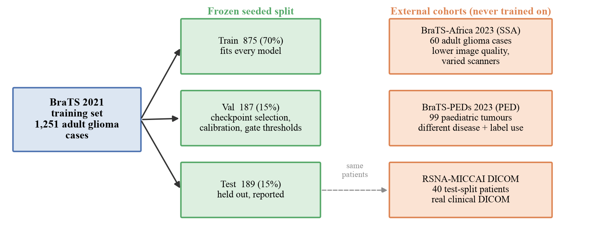

**Figure 2.** Data used in the project: the frozen BraTS 2021 split and the external evaluation sets.

**Table 3.** Datasets and their role.

| Dataset | Cases | Role | Used for fitting? |
| --- | --- | --- | --- |
| BraTS 2021 train split | 875 | Train every model | Yes |
| BraTS 2021 validation split | 187 | Checkpoint selection, calibration, conformal threshold, gate thresholds | Yes: selection, temperature, conformal threshold, QC cut-points, gate thresholds |
| BraTS 2021 test split | 189 | In-distribution evaluation | No |
| BraTS-Africa 2023 | 60 | External evaluation (imaging shift) | No (except cross-fitted fine-tune, §6.8) |
| BraTS-PEDs 2023 | 99 | External evaluation (population and label shift) | No (except cross-fitted fine-tune, §6.8) |
| RSNA-MICCAI DICOM | 40 | Real-DICOM front-end validation | No |

## 3.3 Preprocessing

Each case is reoriented from its own affine, kept at 1 mm isotropic spacing, normalised with a z-score computed over non-zero (brain) voxels for each sequence, and cropped to the bounding box of the brain. Images are stored as float16 and labels as uint8 NumPy arrays with a per-case metadata file recording the crop box and orientation, so predictions can be restored exactly to the original grid. The raw labels are converted to the three nested region channels (ET ⊂ TC ⊂ WT) used for training and scoring. All 1,251 cases were preprocessed without failure (34.2 GB). SHA-256 manifests are committed for the external cohorts.

## 3.4 Ethics and data licences

All imaging data are public, de-identified research releases used under their published terms: BraTS 2021 (RSNA-ASNR-MICCAI challenge data), BraTS-Africa 2023 and BraTS-PEDs 2023 (Synapse challenge releases), and the RSNA-MICCAI Brain Tumor Radiogenomic Classification DICOM (Kaggle competition data, rules accepted 2026-09-26). No new data were collected from people and no ethics approval was required for this secondary analysis. The data terms forbid redistribution: the preprocessed copies used for GPU training are held in private Kaggle datasets, and no image or label is published with this report or the code. Model weights trained on these data are not released until their terms have been checked (recorded as a release task).

<!-- pagebreak -->

# 4. Methodology

## 4.1 Proposed model: NeuroVision-X

The model (Figure 3) has five parts. A **3D CNN encoder** of residual blocks produces five feature levels, from a full-resolution stem of 32 channels down to 320 channels at stride 16. A **Swin Transformer encoder** with four stages processes the same input through patch embedding and shifted-window self-attention, providing long-range context. At each of the four Swin levels an **adaptive gated cross-attention fusion block** merges the two streams. A **U-Net decoder** upsamples the fused features with learned transposed convolutions and skip connections (attention gates exist in the code but are switched off in every trained model). Three **heads** produce the outputs: a segmentation head with deep supervision emitting ET, TC and WT logits, plus a confidence head and a boundary head used as auxiliary training signals. The model has **34,911,341 parameters**; most of them are in the CNN encoder (18.9 M) and decoder (12.9 M), while the Swin branch has only 2.0 M and the fusion blocks 1.0 M.

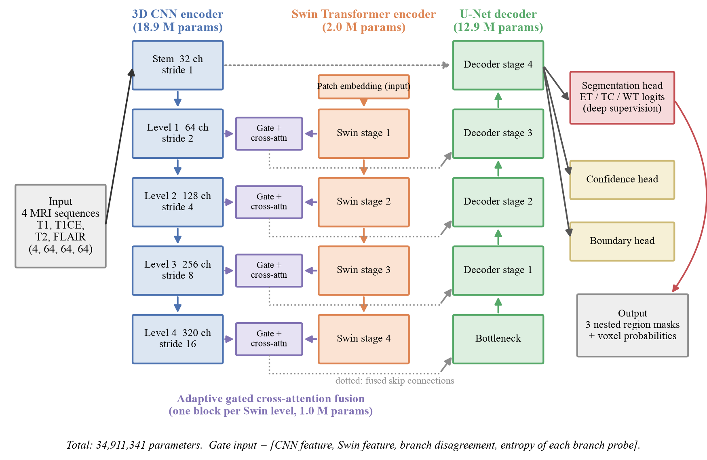

**Figure 3.** NeuroVision-X architecture: dual encoder, gated cross-attention fusion at four scales, U-Net decoder and three heads.

### 4.1.1 The fusion block and the founding hypothesis

Inside each fusion block (Figure 4), the Swin feature is first projected to the CNN width. Windowed cross-attention lets each CNN location query the Swin features around it. A gate generator produces a per-voxel weight *g* between 0 and 1, and the output is the CNN feature plus a learned layer scale times *g* times the attention output. The proposed novelty was the gate's input: besides the two feature maps, it receives an **ambiguity signal** computed by two small probe layers that predict region probabilities from each branch separately, namely their absolute disagreement and the entropy of each. The hypothesis (P2 in the pre-registration) was that this disagreement conditioning is what makes the architecture work. A parameter-matched ablation, the *content-only gate*, removes exactly these inputs (a difference of 6,360 parameters, 0.018%).

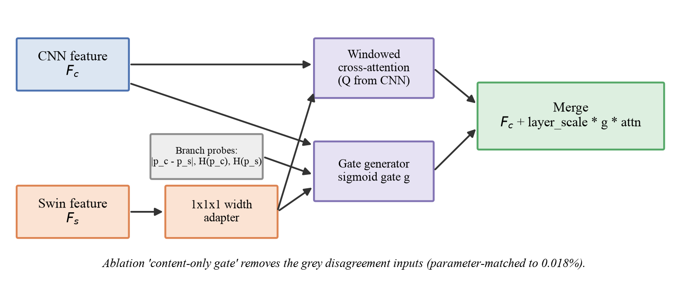

**Figure 4.** Adaptive gated cross-attention fusion block. The grey disagreement inputs are what the content-only ablation removes.

## 4.2 Baselines and controls

A claim that one architecture beats another is only as good as its comparison. The project therefore trained a ladder of controls, each differing from the proposed model in one controlled way (Table 4).

**Table 4.** Models trained and compared.

| Model | Params | Purpose |
| --- | --- | --- |
| Matched 3D U-Net (MONAI) | 12.9 M | Same recipe, same data, same seed: the comparison row |
| Capacity control U-Net | 34.8 M | U-Net widened to the proposed model's size, to separate width from architecture (trained twice) |
| Content-only gate ablation | 34.9 M | Proposed model without disagreement conditioning: tests the founding hypothesis |
| NeuroVision-X seed 43 | 34.9 M | Second seed: measures the seed-to-seed noise floor |
| U-Net seed 43 | 12.9 M | Second seed of the baseline: replication of the headline |
| NeuroVision-X, heavy augmentation | 34.9 M | Rotation, gamma, bias field, elastic: does augmentation close the shift gap? |
| nnU-Net v2 3d_fullres | default | The field's standard: full 1000-epoch recipe on the same 875 cases |

## 4.3 Training

All project models share one recipe, fixed after a timing probe showed the proposed model was 10.7 times slower per epoch than the U-Net at 96³ patches: **64³ patches, 80 epochs**, AdamW (learning rate 1 × 10⁻⁴, weight decay 1 × 10⁻⁵), five warm-up epochs followed by a cosine schedule, batch size 1 with four patches per step, automatic mixed precision, and gradient clipping at norm 5. Augmentation is random flips, 90° rotations, ±10% intensity scale and shift, and light Gaussian noise. The loss is a multitask loss: Dice plus binary cross-entropy with deep supervision for segmentation, plus a boundary term (weight 0.3), a confidence term (0.05) and a branch-consistency term on the probe layers (0.1). The checkpoint with the best mean validation Dice is kept; for the deployed model this was epoch 69 of 80.

Training ran on Kaggle Tesla T4 GPUs (14.56 GiB usable) in sessions capped at 12 hours. The trainer therefore supports **full resume** from any point: model, optimiser, scheduler, mixed-precision scaler, epoch, global step, every random-number-generator state and the experiment-tracking run ID are checkpointed atomically. The deployed model took 23.1 GPU-hours over three chained sessions.

## 4.4 Inference and post-processing

Whole volumes are segmented with a sliding window of 64³, overlap 0.5 and Gaussian blending. Post-processing enforces the nesting ET ⊂ TC ⊂ WT and removes connected components smaller than 50 voxels, and predictions are restored to the original 240 × 240 × 155 grid with the saved crop box. Inference took 11.9 s per case on a T4 (189 test cases in 35 min 43 s) and about 1.4 minutes per case on the author's laptop CPU. Logits for every evaluated split are saved in float16, so all later re-scoring (new metrics, conformal analysis, recalibration) needs no new inference.

## 4.5 Evaluation metrics

- **Voxel-wise Dice** per region, the BraTS convention up to 2022: 2|A ∩ B| / (|A| + |B|). An empty prediction of an empty reference scores 1.
- **Lesion-wise Dice**, the BraTS convention since 2023: each connected lesion is matched separately, so missed small lesions and spurious false-positive lesions are penalised. It is reported alongside voxel Dice.
- **HD95**, the 95th-percentile Hausdorff distance in millimetres, measuring boundary error.
- **Usable mask**: a study counts as usable when both WT and TC Dice are at least 0.7; **silent failure** is a study that the gate accepts but whose mask is not usable.
- **Realised risk**: the mean fraction of reference tumour voxels that the conservative mask misses, compared with the nominal level α.

## 4.6 Statistical protocol and pre-registration

Every comparison is **paired** over the same cases. Confidence intervals come from a paired bootstrap that resamples case indices (10,000 resamples), p-values from the Wilcoxon signed-rank test, and every family of comparisons is corrected with the Holm–Bonferroni method. A difference is called better or worse only if its CI excludes zero and its Holm-adjusted p is below 0.05; otherwise it is *inconclusive*, which is never read as equivalence.

Each experiment that could change a claim was **pre-registered**: a document stating the hypothesis, the endpoints, the decision rule and an abort budget was committed to version control, with a timestamp, before the first number existed. Fourteen such documents, several with dated amendments, govern the results in this report. Not every one was written before every related output existed: some were written after a neighbouring analysis had been seen, and the repository's timeline table records that ordering for each. Within those limits, this discipline is why the negative results below can be trusted as much as the positive ones.

## 4.7 Uncertainty and quality signals

Four per-voxel uncertainty signals were compared as error localisers: single-pass predictive entropy (free), 10-sample MC dropout, the disagreement between the two branches' probe predictions, and the model's trained confidence head. For per-study quality, a separate 3D CNN, the **QC model**, was trained to predict a mask's own Dice from the image and the mask, using synthetically degraded masks so that it never needed the ground-truth label at inference.

## 4.8 Conformal risk control

Conformal risk control converts the network's voxel probabilities into a mask with a guarantee (Figure 5). A threshold λ is chosen on the calibration set (BraTS validation, 187 cases) as the largest value whose adjusted miss rate, (n·R(λ) + 1)/(n + 1), stays at or below the target α. Frozen and applied to new studies, it guarantees that the *expected* fraction of tumour voxels missed is at most α, provided the new studies are exchangeable with the calibration set. The project used α = 0.05, 0.10 and 0.20 for WT and TC. The guarantee is a theorem and holds for any model, even a poor one; the interesting question is what happens when exchangeability is broken by distribution shift.

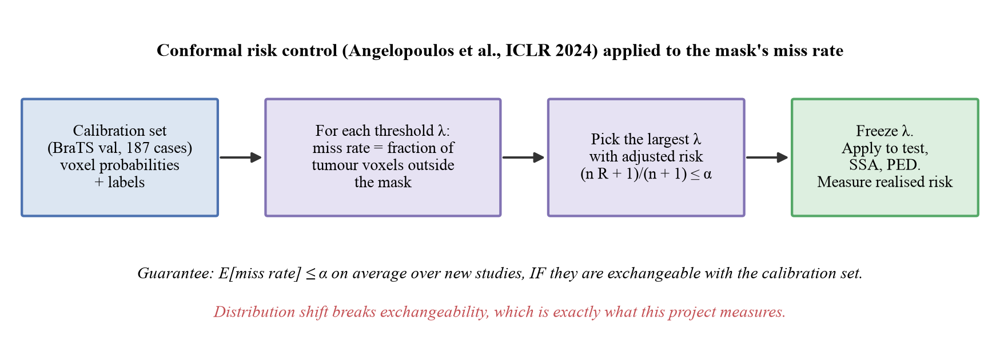

**Figure 5.** Conformal risk control applied to the mask's miss rate.

## 4.9 Local recalibration and fine-tuning

To ask what a new site would need, each shifted cohort was split 1,000 times with a seeded generator; the threshold was refitted on k of the cohort's own labelled cases (k = 5 to 49) and the miss rate measured on the rest. This is a **counterfactual** analysis on public data, not a site study. Separately, the deployed model was **fine-tuned** on half of each external cohort and scored on the other half, then the halves were swapped (two-fold cross-fitting), so that every case was scored by a model that never saw it.

## 4.10 Refusal gate

The gatekeeper combines signals into PROCEED, PROCEED WITH CAUTION or REFUSE. Live signals are label-free input quality control (twelve checks on intensity, geometry, slice thickness and registration), the QC model's predicted Dice, and an intended-use rule (adults only, read from the DICOM PatientAge field). The conformal band and an input-statistics out-of-distribution score are shown but are display-only, because each failed its pre-registered rule for refusing studies. All thresholds were fitted on validation only. A refused job is treated as a successful outcome of the pipeline, never as an error.

<!-- pagebreak -->

# 5. System Design and Implementation

## 5.1 Software architecture

The code base (Figure 6) is a Python 3.11 package with four parts in separate dependency environments so that none can break another: the research path (training, inference, metrics, statistics), the clinical path (DICOM ingest, registration, skull stripping, gating, export), the interpretable layer (atlas, localisation, reports) and the web application. Every script is driven by Hydra configuration; models, losses and fusion blocks are selected by name from registries, so an experiment is a configuration change rather than a code change. No path is hard-coded and the same code runs on macOS and Linux, on CPU for tests and on CUDA for training.

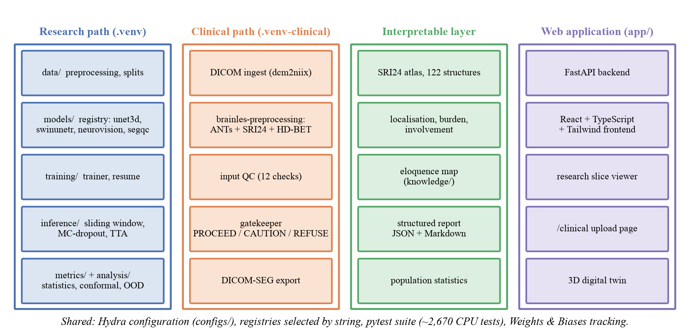

**Figure 6.** Software architecture of NeuroVision-X.

**Table 5.** Technology stack.

| Area | Tools |
| --- | --- |
| Language and deep learning | Python 3.11, PyTorch, MONAI (transforms, sliding-window inference, metrics) |
| Configuration and tracking | Hydra, Weights & Biases |
| Medical imaging I/O | NiBabel, SimpleITK, dcm2niix, highdicom (DICOM-SEG) |
| Clinical preprocessing | BrainLes preprocessing (ANTs registration, SRI24 atlas), HD-BET skull stripping |
| Analysis | NumPy, Pandas, SciPy, scikit-image, Captum (explainability) |
| Baseline | nnU-Net v2 (separate environment, Kaggle) |
| Web application | FastAPI backend; React, TypeScript, Vite and Tailwind frontend; 3D rendering in the browser |
| Quality | pytest (about 2,670 CPU tests in about 70 s), Ruff, Black, vitest, headless-Chrome end-to-end tests |
| Compute | Kaggle Tesla T4 for training; Apple M4 laptop (CPU) for everything else |

## 5.2 The clinical pipeline

The clinical pipeline (Figure 7) accepts a zipped DICOM study through the web page at /clinical. **Ingest** converts each series to NIfTI with dcm2niix, assigns the four sequence roles from a rule table and reads the patient's age. **Input QC** runs before registration, then the study is co-registered to its T1CE series, registered to the SRI24 atlas that BraTS itself uses, and skull-stripped with HD-BET, so that it lands in the same space as the training data. Input QC runs again, the model segments the study, the QC model and conformal band are computed, and the **gatekeeper** decides. Outputs include a 3D digital twin of the brain with tumour and atlas structure shells and uncertainty and Grad-CAM layers, a structured report, a DICOM-SEG object that loads in standard viewers, and a downloadable bundle. A single clinical job peaks at about 12 GB of memory on the laptop.

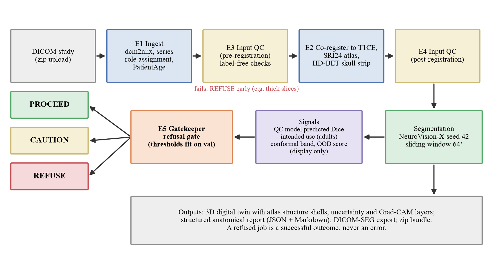

**Figure 7.** Clinical pipeline from a DICOM study to a gated result.

## 5.3 Interpretable report layer

The report layer reads a mask in SRI24 atlas space (122 merged anatomical structures) and computes, for each case, which structures the tumour involves and what fraction of each structure is affected, its lobe, laterality and midline crossing, sub-region volumes and shape descriptors, and its distance to functionally eloquent structures from a source-derived knowledge base. The report carries its non-diagnostic disclaimer, atlas version, provenance and a list of what it does not claim as required fields. Midline shift was deliberately not implemented, because no public MRI ground truth exists to validate it. Two atlas traps were found and fixed during this work: the SRI24 atlas is mirrored front-to-back relative to BraTS indexing, and a brain-mask overlap check cannot detect a left–right mirrored atlas (it scores higher on the wrong orientation), so laterality is verified from 56 labelled structure pairs instead.

## 5.4 Web application

The FastAPI backend serves precomputed research results and runs live clinical jobs; the React frontend provides a research slice viewer with ground-truth, prediction and uncertainty overlays, the /clinical upload page with a gatekeeper panel and refusal banner, the 3D digital twin (Figure 8), the report pages and export. The interface wording was checked so that no string says "guaranteed" without "on average, in distribution, not per patient".

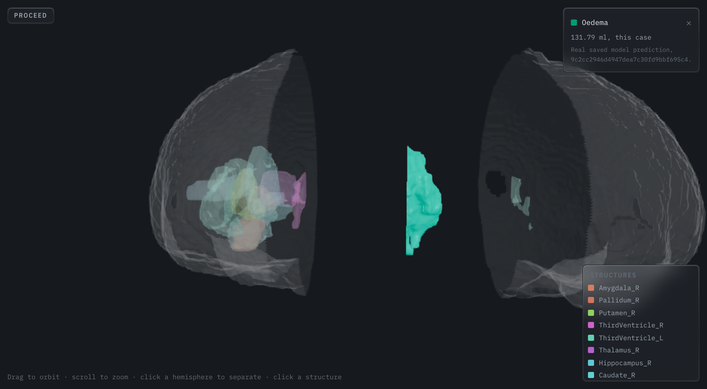

**Figure 8.** The 3D digital twin of a real DICOM study that the gate passed (PROCEED): separated hemispheres, predicted oedema and involved atlas structures.

## 5.5 Engineering practices

- **Tests written with every component.** Each module was implemented together with its tests, in the same step, by the implementing agent; tests were not written before the code. Every model part has a CPU shape test on tiny tensors that runs in under a second; losses and metrics are tested against hand-computed values; data tests use synthetic volumes. The full suite runs on a laptop CPU in about 70 seconds.
- **Resume and provenance.** Every GPU run is pinned to a specific git commit and checked for resume correctness by seven dedicated tests; a four-second end-to-end smoke test runs before every GPU session.
- **Analysis fixes are verified on real data.** A fix is accepted only when re-running the real analysis moves the output in the predicted direction, after a calibration bug once survived a green test suite.
- **Caches versus results.** Volume-sized arrays (logits, predictions) are treated as rebuildable caches while their checkpoint exists; small CSV results are kept forever.

## 5.6 Compute

All training ran on the Kaggle free tier (Tesla T4, about 30 GPU-hours per week), roughly 210 GPU-hours in total across 18 tracked training runs, including about 59 GPU-hours for the nnU-Net baseline. Everything else, including evaluation, calibration, statistics, the clinical pipeline and the web application, ran on an Apple M4 laptop CPU.

<!-- pagebreak -->

# 6. Results

Every number in this chapter is taken from the project's claims-and-evidence table, in which each claim is tied to the artifact that produced it. Results are reported whether they support the original hypothesis or not.

## 6.1 Segmentation accuracy in distribution

On the 189-case test split, NeuroVision-X improves enhancing-tumour Dice over the matched U-Net by **+0.0267** (95% CI 0.0166 to 0.0393; Holm-adjusted p = 1.4 × 10⁻²¹) and tumour-core Dice by +0.0103; the whole-tumour difference is inconclusive (Table 6, Figure 9). The result replicates at a second seed of both models (+0.0247, CI 0.0116 to 0.0420). A second seed of NeuroVision-X alone moves test ET Dice by +0.0021 and a second seed of the U-Net by +0.0041, so the margin is about six times the larger of these retraining shifts. About 40% of the +0.0267 comes from two of the five test cases with no enhancing tumour in the reference, which NeuroVision-X scores as 1 and the U-Net as 0 at both seeds; on the 184 cases with enhancing tumour the gain is **+0.0165** (CI 0.0125 to 0.0211), about four times the larger retraining shift. Both figures are reported; the direction is unchanged. Flip test-time augmentation changes ET Dice by +0.0007, not resolvable at n = 189, so the margin is not an artefact of inference settings.

**Table 6.** Test-set results (BraTS 2021 test split, n = 189). Higher Dice and lower HD95 are better.

| Metric | Matched U-Net | NeuroVision-X | nnU-Net v2 |
| --- | --- | --- | --- |
| Dice ET | 0.8442 | 0.8709 | 0.8879 |
| Dice TC | 0.9058 | 0.9161 | 0.9247 |
| Dice WT | 0.9276 | 0.9321 | 0.9424 |
| Lesion-wise Dice ET | — | 0.7550 | 0.7859 |
| HD95 ET (mm) | 4.91 | 4.20 | — |

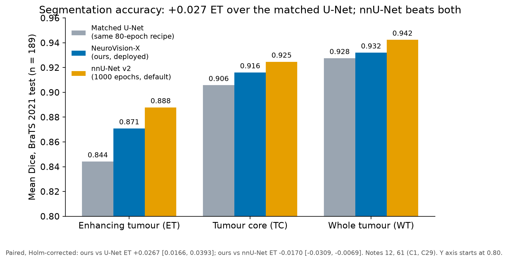

**Figure 9.** Mean test Dice per region for the matched U-Net, NeuroVision-X and nnU-Net v2.

## 6.2 Where the gain comes from

The width-matched capacity control (34.83 M vs 34.91 M parameters) recovers +0.0055 of the ET gain, which would attribute about 80% of it to architecture rather than capacity (0.79 and 0.80 over two independent training draws of the control). This split is descriptive, not a measured proportion: each arm is a single seed of its model, and the width term (+0.0055) is the same size as the seed-to-seed shift (+0.0041), so the decomposition is within noise of quite different splits. Within the architecture, the content-only gate ablation scores within noise of the full model (+0.0022, CI −0.0067 to +0.0152): the gain comes from **gated cross-attention fusion itself**, and the disagreement conditioning, the project's founding hypothesis, adds nothing measurable (Figure 10). This is a pre-registered null and is reported as one.

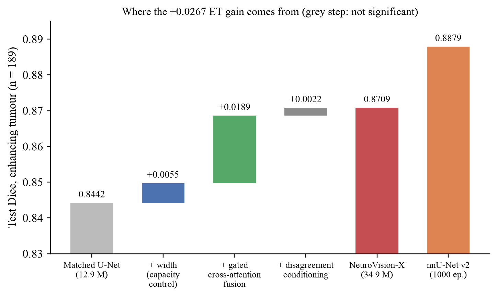

**Figure 10.** Decomposition of the enhancing-tumour Dice gain over the matched U-Net, with nnU-Net for reference.

## 6.3 The strong baseline: nnU-Net

nnU-Net v2, trained with its default plans and full 1000-epoch recipe on the same 875 cases, beats NeuroVision-X on both pre-registered co-primary endpoints: voxel ET Dice 0.8879 vs 0.8709 (−0.0170, CI −0.0309 to −0.0069, p_holm = 1.0 × 10⁻⁷) and lesion-wise ET Dice 0.7859 vs 0.7550 (−0.0309, CI −0.0605 to −0.0020). It is better on every Dice row. Mirroring at test time does not explain the gap (without it nnU-Net still leads by 0.0113). nnU-Net beats the matched U-Net by +0.0437, so the weak link is the project's shorter training recipe (80 epochs, 64³ patches), not the U-Net topology. nnU-Net also used about 2.7 times the GPU time (about 59 vs 22 T4-hours). By the rule fixed in advance, **the architecture claim is withdrawn**: the +0.0267 gain is real but holds only against a matched-recipe U-Net.

## 6.4 Lesion-wise scoring

Under lesion-wise scoring the in-distribution gain over the matched U-Net is larger (ET +0.0508, TC +0.0371; exploratory, not pre-registered) and comes from fewer spurious lesions (0.32 vs 0.47 false-positive ET lesions per case) rather than better recall. Voxel Dice overstates absolute performance for both models by 0.10 to 0.32; NeuroVision-X whole tumour reads 0.9321 voxel-wise and only 0.7183 lesion-wise, because one large lesion dominates the voxel count.

## 6.5 Out of distribution

Accuracy falls with distance from the training data (Table 7, Figure 11), and the ET gain over the U-Net does not transfer: on the external cohorts it disappears, and tumour-core Dice is significantly worse than the U-Net's on pooled shifted data (−0.0333, p_holm = 0.0132). Heavier simulated augmentation does not close the gap: 12 of 12 pre-registered comparisons are inconclusive, and the pooled tumour-core change (+0.0117) is the same size as seed noise.

**Table 7.** NeuroVision-X voxel Dice by cohort.

| Cohort | n | Dice ET | Dice TC | Dice WT |
| --- | --- | --- | --- | --- |
| BraTS test (in distribution) | 189 | 0.8709 | 0.9161 | 0.9321 |
| BraTS-Africa (SSA) | 60 | 0.7784 | 0.7846 | 0.8959 |
| Paediatric BraTS (PED) | 99 | 0.5634 | 0.4394 | 0.8490 |

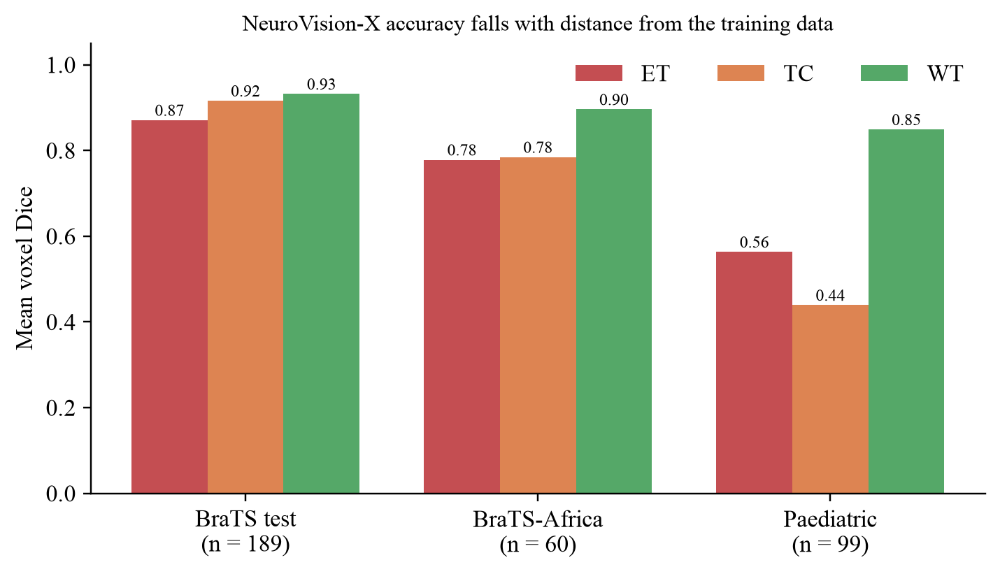

**Figure 11.** NeuroVision-X accuracy on the in-distribution test set and the two external cohorts.

## 6.6 Uncertainty mechanisms

Single-pass predictive entropy was never beaten as a per-voxel error localiser. Ten-sample MC dropout is statistically equivalent to it (paired equivalence test at a margin of 0.03 AUROC fixed in advance), branch disagreement is worse (by 0.157 AUROC on SSA and 0.056 on PED against MC dropout), and the trained confidence head is worse on every region (ET 0.855 vs 0.912; uninformative on WT). Branch disagreement does carry some per-voxel information that entropy lacks (residualised AUROC 0.578, 0.569 and 0.677 on test, SSA and PED), but adding it to a fitted detector did not improve it. Calibration, boundary accuracy and MC-dropout risk-coverage were all within noise of the U-Net against a temperature-scaled baseline: the model is more accurate, not more reliable.

## 6.7 The error bound: where it holds and where it breaks

Calibrated on validation and applied frozen, the conformal bound **holds in distribution in all six cells** (WT and TC at three α levels), with realised risk at 0.64 to 0.96 times nominal, for both NeuroVision-X and the U-Net. Its cost is small: at α = 0.05 the conservative mask grows 1.10 times (WT) and 1.18 times (TC), and at looser α it is even smaller than the default mask. Under deployment change the bound **breaks** (Figure 12): BraTS-Africa whole tumour about 1.1 times nominal, paediatric whole tumour 1.4 to 1.9 times, and paediatric tumour core 3.5 to 11.5 times. Seven of twelve shifted cells are violated for each model. Most of the paediatric tumour-core failure is a difference in label definition rather than imaging alone: the paediatric reference counts most non-enhancing tumour as core (median 84% of the core), which the adult convention calls oedema. With only three cohorts, the failures cannot be ordered by the size of the shift, and no such ordering is claimed.

**The same analysis on nnU-Net** (pre-registered before any nnU-Net probability existed) asks whether this is a weakness of the project's model or of the method. The registered verdict is **REPLICATES**. nnU-Net holds the bound in all six in-distribution cells and breaks it in 5 of 12 shifted cells, including paediatric tumour core at every α (realised miss rate 0.555, 0.624 and 0.630 against α = 0.05, 0.10 and 0.20). Descriptively, the stronger model shrinks the damage where the label definition is unchanged: its realised risk is lower than NeuroVision-X's in 9 of the 12 shifted cells, and it segments better under shift on whole tumour (BraTS-Africa +0.024, paediatric +0.042 Dice). It does not repair the label case. Even at the most permissive threshold, nnU-Net misses 48.6% of the paediatric tumour core (NeuroVision-X: 35.6%), so no threshold reaches the target for either model. At α = 0.20 the fitted threshold sits at the top of the search grid for every model, so those cells measure risk at the grid ceiling.

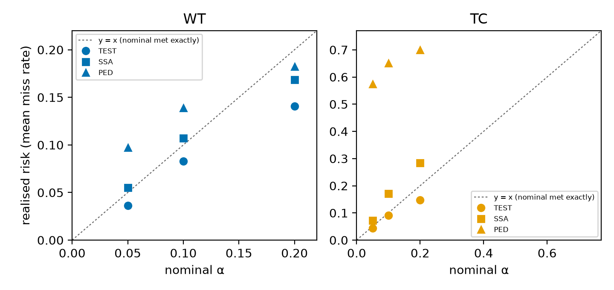

**Figure 12.** Realised versus nominal risk for whole tumour and tumour core per cohort. Points above the diagonal violate the bound.

## 6.8 What a new site would need

In the counterfactual recalibration analysis, about **10 to 40 local labelled cases**, depending on α, restore the bound for whole tumour on BraTS-Africa and paediatric data and for tumour core on BraTS-Africa (Figure 13). **Paediatric tumour core cannot be restored at any k**: even at the lowest possible threshold the model misses 35.6% of the paediatric tumour core, above every α tested. This was derived and written down before the run.

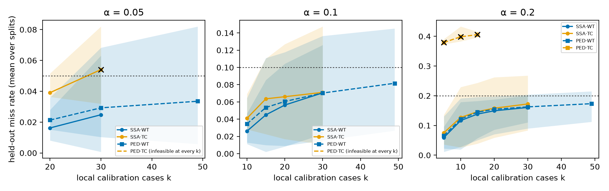

**Figure 13.** Held-out miss rate against the number of local calibration cases k; crosses mark cells that do not meet the target.

Changing the model does what recalibration cannot. Cross-fitted fine-tuning on half of each cohort recovers tumour-core Dice on both: BraTS-Africa +0.0433 (0.785 → 0.828) and paediatric +0.3676 (0.439 → 0.807). After fine-tuning, paediatric tumour core becomes restorable by local recalibration at α = 0.10 and 0.20. Most of the paediatric gain is the model learning the paediatric label convention (its predicted core-to-whole-tumour ratio moved from 0.27 to 0.95), not better imaging generalisation. These results are cross-fitted, not external validation; the deployed model is unchanged.

## 6.9 The end-to-end pipeline and its refusal gate

Measured through every stage with the deployed, frozen gate (Figure 14), the pipeline returns a usable mask for **85.2%** of in-distribution studies, **78.3%** of BraTS-Africa studies and **24.2%** of paediatric studies, with silent-failure rates of **4.2%, 18.3% and 49.5%**. Almost all silent failures fail on tumour core alone (8 of 8 in distribution, 9 of 11 on BraTS-Africa, 44 of 49 on paediatric data); judged on whole tumour alone the silent-failure rates would be 0%, 3.3% and 5.1%, so the paediatric figure is largely the changed tumour-core label. The gate has decent precision and poor recall, and it is blind to cohort-level shift: on BraTS-Africa it refuses 2 of 60 studies while passing 11 of 12 unusable masks; on paediatric data 23 of 26 refusals are correct but it catches only 32% of unusable masks. Gate acceptance does not repair the bound where it is broken (paediatric tumour-core risk 0.573 on accepted cases at a nominal 0.10). The QC model behind the gate beats entropy in one of five pre-registered cells, loses significantly in one, loses in a third by a margin just outside the registered bar (Holm-adjusted p = 0.0504), and becomes more optimistic under shift in all six external cells. An adults-only intended-use rule removes every paediatric study by construction, which is scoping, not detection.

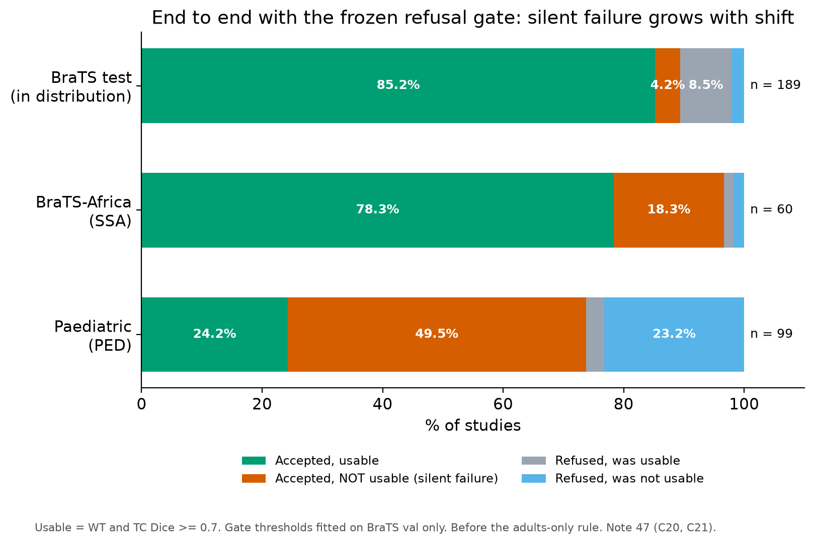

**Figure 14.** End-to-end outcome of each study with the frozen refusal gate, per cohort.

## 6.10 Real clinical DICOM and the out-of-distribution score

On original DICOM of 40 test-split patients, the clinical front end refuses 40% of studies for thick slices; of the 22 it accepts, only 36% are usable against the BraTS reference, and whole-tumour Dice falls by a median 0.23 relative to the research path. Most of that loss is a median 5.9 mm disagreement between the project's rigid registration to the atlas and BraTS's own, counted against the pipeline by design because the report's anatomy is read in atlas space. A pre-registered out-of-distribution score computed from input statistics flags 60% of BraTS-Africa studies against 9.5% of test studies, so it sees the shifted cohort, but it ranks failed masks barely above chance (AUROC 0.56 to 0.60) and failed its rule for becoming a refusal signal; it stays display-only.

## 6.11 Hypothesis scoreboard

Table 8 lists every hypothesis the project tested, in order, with its verdict.

**Table 8.** Hypotheses tested and their outcome.

| Hypothesis | Verdict | Key evidence |
| --- | --- | --- |
| Dual encoder beats a matched U-Net on Dice | Supported | ET +0.0267 (+0.0165 on ET-present cases), TC +0.0103; WT inconclusive |
| …with better calibration, boundaries, risk-coverage | Refuted | All within noise |
| The gain is architecture, not width | Supported, descriptive | ~80% architecture over two control draws; single-seed arms, width term at seed-noise size |
| Disagreement conditioning produces the gain (founding hypothesis) | Null | +0.0022, CI −0.0067 to +0.0152 |
| A better segmentation gives a better report | Refuted | 1 of 25 report metrics |
| The gain transfers to external cohorts | Refuted | Gone on SSA and PED; TC worse |
| Disagreement detects failure beyond entropy | Partial | Per voxel yes, per case no |
| Disagreement matches MC dropout at a tenth of the cost | Refuted | Worse; entropy equals MC dropout |
| Conformal bound holds in distribution | Supported | 6 of 6 cells |
| …and survives distribution shift | Refuted | Breaks in 7 of 12 cells; worst on PED TC (label definition) |
| The shift failure is specific to the weaker model | Refuted | Replicates on nnU-Net: 5 of 12 violated, PED TC at every α |
| QC model beats entropy at flagging bad masks | Mixed | 1 win, 1 loss, 1 borderline of 5 |
| The refusal gate makes the pipeline safe under shift | Refuted | Silent failure 4.2 / 18.3 / 49.5% |
| Heavy augmentation closes the shift gap | Null | 12 of 12 inconclusive |
| Local labels restore the bound | Supported* | 10–40 cases, except PED TC (counterfactual) |
| Front end costs ≤ 0.05 WT Dice on real DICOM | Refuted | Median −0.23 |
| Input OOD score earns a refusal role | Refuted | Sees cohort, not failed study |
| Fine-tuning recovers tumour core | Supported* | SSA +0.043, PED +0.368 (cross-fitted) |
| The gain survives nnU-Net | Refuted | nnU-Net ET 0.8879 vs 0.8709 |

*Counterfactual or cross-fitted, not external validation.

<!-- pagebreak -->

# 7. Discussion

The architecture result is modest, in distribution, and relative. Gated cross-attention fusion does produce a real, attributable enhancing-tumour gain over a matched U-Net, but a standard nnU-Net with a longer training recipe exceeds it, the gain does not transfer to new populations, and the mechanism the project was built around is not what produces it. This matches the broader finding of *nnU-Net Revisited* that architectural gains over weak baselines tend to evaporate against a properly configured CNN, and it is the reason the project's contribution moved away from the architecture.

The more useful result concerns the reliability machinery around any model. A distribution-free bound is only as good as the exchangeability behind it. It held in every in-distribution cell, at small cost, for all three models. Under deployment change it degraded in two different ways. On African adult gliomas, where the images change but the labels mean the same thing, the excess was small and a stronger model (nnU-Net) reduced it. On paediatric tumour core, where the reference labels define the core differently, it failed by an order of magnitude for every model, and no threshold could meet the target. A learned refusal gate did not see that shift coming, because each of its inputs is calibrated on the same distribution that the shift moves away from; the QC model even became more confident where the segmentation was worst. What restored the bound was local data: tens of labelled cases at a new site, except where the model's failure is so large that no threshold can meet the target. There, changing the model helped, largely by teaching it a different label convention, which is itself a finding about what "shift" means between datasets.

Two practical lessons follow. First, a single accuracy number, even with a confidence interval, is a weak description of a clinical segmentation tool; the silent-failure rate per population and the cost of the front end on real DICOM say much more. Second, free single-pass entropy was never beaten by the more elaborate uncertainty mechanisms built here, so any new mechanism should be compared against it first.

Finally, the negative results are the evidence for the final claim rather than an embarrassment within it. Because every experiment was pre-registered with an abort budget and a decision rule, a reader can check that the positive results were not selected after the fact.

<!-- pagebreak -->

# 8. Limitations

1. Most models are single-seed. The noise floor comes from one seed pair, which is a floor, not a variance estimate, so a margin below it is not claimable and every null means no detectable difference at the sample size, not equivalence.
2. The headline gain holds only against a matched-recipe U-Net; nnU-Net beats the proposed model. nnU-Net was trained once (one fold, one seed) with about 2.7 times the GPU time.
3. No transformer baseline such as SwinUNETR was trained on the same split, for budget reasons.
4. The test split is a random split of the BraTS 2021 training set, so the numbers are not comparable to published challenge results; lesion-wise results are exploratory.
5. The local-recalibration result is a counterfactual on public cohorts, not a site study. The fine-tuning result is cross-fitted, single-seed, and its effect on in-distribution accuracy (forgetting) was not measured.
6. The real-DICOM study uses the same patients as the test split and measures loss in atlas space, where registration disagreement counts against the pipeline.
7. Conformal thresholds at α = 0.20 lie at the edge of the search grid, and the calibration split was also used for checkpoint selection, which could in principle make the threshold optimistic (it did not in practice).
8. The anatomical eloquence field is degenerate on this cohort (every case is near an eloquent structure), so it carries no per-case information.
9. The demonstration PROCEED study is a BraTS training patient.
10. The system is not for clinical use. The bound is an average over studies, in distribution, never a statement about one patient.

<!-- pagebreak -->

# 9. Engineering Lessons

Several traps cost real GPU hours, wrong numbers or silent bugs. They are recorded here because each one passed a fully green test suite.

**Table 9.** Engineering traps found during the project.

| Trap | Consequence | Rule adopted |
| --- | --- | --- |
| A calibration reporting mask selected voxels using the ground-truth label | 41–57% of reported calibration error was an artefact; a first "fix" changed no call site | A reporting mask never touches the label; verify fixes by re-running the real analysis |
| An fp32-sized clamp (1 − 10⁻⁶) rounds to exactly 1.0 in fp16 | 10.5 GPU-hours of training on NaN with nothing raising | Compute entropy from logits; probes must reach the failure condition |
| Brain-mask Dice scores higher on a left–right mirrored atlas | The widest-margin alignment check was blind to the worst error | Verify laterality from labelled structure pairs |
| Error shares computed from rates, not voxel counts | Headline "92% of error within 2 mm" was really 74% | Weight by voxel count |
| Evaluation mode switch disabled MC dropout recursively | A silently deterministic "uncertainty" map | Re-enable only dropout layers explicitly, and test it |
| Batching sliding windows on CPU | 12.4 GiB vs 5.4 GiB peak memory and 57% slower | sw_batch_size = 1 on the laptop |
| Short tokens matched against paths ("val" in "eval", "_t1" in "_t1ce") | Mislabelled splits and sequences | Match whole tokens |
| Checkpoints written to temporary storage | Two checkpoints lost forever, so those runs can never be re-scored | Treat checkpoints as the only irreplaceable artifact |

<!-- pagebreak -->

# 10. Conclusion and Future Work

## 10.1 Conclusion

NeuroVision-X delivers a complete, tested brain tumour segmentation system, from a DICOM study to a gated, explained result in a web application, and a measured account of how far its reliability machinery can be trusted. Its dual-encoder model improves enhancing-tumour Dice over a matched U-Net by +0.0267, mostly through gated cross-attention fusion, but nnU-Net beats it and its founding hypothesis returned a null. A conformal bound on the mask's miss rate holds in distribution for all three models tested, degrades under acquisition and population change, and fails outright where the label definition changes, for nnU-Net as well; the refusal gate sees bad masks, not changed cohorts; and a new site needs roughly 10 to 40 labelled cases to restore the bound, or a fine-tuned model where the failure is too large for any threshold. The project's lasting contribution is less a model than a method: pre-registered, honestly reported measurement of where a medical-imaging AI system holds and where it breaks.

## 10.2 Future work

- Evaluate the pooled multi-cohort training run (BraTS + BraTS-Africa + paediatric, completed in October 2026) under its pre-registration.
- Run at least three seeds per model so that equivalence, not just difference, can be tested.
- Replace the uncertified refusal gate with a certified selective risk-control approach, and test site-conditional recalibration on a real multi-site cohort.
- Decide in January 2027 whether to add IDH molecular subtyping on UCSF-PDGM for the capstone, then write and submit the MELBA journal paper around April 2027.

<!-- pagebreak -->

# References

[1] Angelopoulos, A. N., Bates, S., Fisch, A., Lei, L., and Schuster, T. Conformal risk control. International Conference on Learning Representations (ICLR), 2024. arXiv:2208.02814.

[2] Bates, S., Angelopoulos, A., Lei, L., Malik, J., and Jordan, M. Distribution-free, risk-controlling prediction sets. Journal of the ACM, 68(6), 2021. arXiv:2101.02703.

[3] Tibshirani, R. J., Barber, R. F., Candès, E., and Ramdas, A. Conformal prediction under covariate shift. Advances in Neural Information Processing Systems (NeurIPS), 2019. arXiv:1904.06019.

[4] Vovk, V., Gammerman, A., and Shafer, G. Algorithmic Learning in a Random World. Springer, 2005.

[5] Isensee, F., Jaeger, P. F., Kohl, S. A. A., Petersen, J., and Maier-Hein, K. H. nnU-Net: a self-configuring method for deep learning-based biomedical image segmentation. Nature Methods, 18, 203–211, 2021.

[6] Isensee, F., et al. nnU-Net Revisited: a call for rigorous validation in 3D medical image segmentation. Medical Image Computing and Computer Assisted Intervention (MICCAI), 2024.

[7] Baid, U., et al. The RSNA-ASNR-MICCAI BraTS 2021 benchmark on brain tumor segmentation and radiogenomic classification. arXiv:2107.02314, 2021.

[8] Menze, B. H., et al. The multimodal brain tumor image segmentation benchmark (BRATS). IEEE Transactions on Medical Imaging, 34(10), 1993–2024, 2015.

[9] Adewole, M., et al. The Brain Tumor Segmentation (BraTS) challenge 2023: glioma segmentation in sub-Saharan Africa patient population (BraTS-Africa). arXiv:2305.19369, 2023.

[10] Kazerooni, A. F., et al. The Brain Tumor Segmentation (BraTS) challenge 2023: focus on pediatrics (CBTN-CONNECT-DIPGR-ASNR-MICCAI BraTS-PEDs). arXiv:2305.17033, 2023.

[11] Ronneberger, O., Fischer, P., and Brox, T. U-Net: convolutional networks for biomedical image segmentation. MICCAI, 2015.

[12] Çiçek, Ö., Abdulkadir, A., Lienkamp, S. S., Brox, T., and Ronneberger, O. 3D U-Net: learning dense volumetric segmentation from sparse annotation. MICCAI, 2016.

[13] Liu, Z., et al. Swin Transformer: hierarchical vision transformer using shifted windows. IEEE/CVF International Conference on Computer Vision (ICCV), 2021.

[14] Hatamizadeh, A., et al. Swin UNETR: Swin transformers for semantic segmentation of brain tumors in MRI images. BrainLes workshop, MICCAI, 2022.

[15] Gal, Y., and Ghahramani, Z. Dropout as a Bayesian approximation: representing model uncertainty in deep learning. International Conference on Machine Learning (ICML), 2016.

[16] Shahid. When average calibration fails: site-conditional federated conformal risk control. arXiv:2606.20115, 2026.

[17] Adhikary, Chabi, and Mastmeyer. Bound-aware per-organ recall risk control for multi-organ CT segmentation under clinical domain shift. arXiv:2608.18193, 2026.

[18] Liu, Qiao, Zhang, and Chen. Certify or refuse: a cross-model map for selective risk control with coverage floors under covariate shift. arXiv:2608.10893, 2026.

[19] Rohlfing, T., Zahr, N. M., Sullivan, E. V., and Pfefferbaum, A. The SRI24 multichannel atlas of normal adult human brain structure. Human Brain Mapping, 31(5), 798–819, 2010.

[20] Isensee, F., et al. Automated brain extraction of multisequence MRI using artificial neural networks (HD-BET). Human Brain Mapping, 40(17), 4952–4964, 2019.

[21] Li, X., Morgan, P. S., Ashburner, J., Smith, J., and Rorden, C. The first step for neuroimaging data analysis: DICOM to NIfTI conversion (dcm2niix). Journal of Neuroscience Methods, 264, 47–56, 2016.

[22] Cardoso, M. J., et al. MONAI: an open-source framework for deep learning in healthcare. arXiv:2211.02701, 2022.

<!-- pagebreak -->

# Appendix A. Training runs and reproducibility

All training ran on Kaggle Tesla T4 GPUs, each run pinned to a git commit. GPU-hours are session wall-clock.

**Table 10.** Main training runs.

| Run | GPU-h | Outcome |
| --- | --- | --- |
| Matched U-Net, 80 epochs, 64³ | ~3.2 | Test ET 0.8442, the comparison row |
| NeuroVision-X (deployed), 3 sessions | 23.1 | Test ET 0.8709, best epoch 69 |
| Capacity control U-Net (two draws) | ~8 + 5.8 | Architecture share 0.79 / 0.80 |
| Content-only gate ablation | 24.2 | Within noise of the full model (P2 null) |
| Heavy augmentation | 23.7 | 12 of 12 inconclusive |
| NeuroVision-X seed 43 | ~23 | Noise floor +0.0021 ET |
| U-Net seed 43 | ~5 | Headline replicated (+0.0247) |
| nnU-Net v2, 1000 epochs, 7 sessions | ~59 | Test ET 0.8879; architecture claim withdrawn |
| Cross-fitted fine-tunes (4 folds) | ~5 | Tumour core recovered on SSA and PED |
| Flip TTA measurement | ~3 | ET +0.0007, inconclusive |
| Pooled multi-cohort training | ~25 | Completed; evaluation pending |

The repository records every result in docs/research_docs/experiments.md (numbered notes), every allowed claim in docs/research_docs/claims_and_evidence.md, the pre-registrations in docs/research_docs/preregistrations/, and the exact rebuild commands in docs/research_docs/reproducibility.md. Saved float16 logits for every evaluated split allow all metrics, conformal analyses and recalibrations to be recomputed without new inference.

<!-- pagebreak -->

# Appendix B. Example segmentations

**Figure 15.** Example BraTS cases (worst, median and best by Dice for a baseline 3D U-Net): FLAIR, ground truth and prediction, with the three label classes NCR/NET, ED and ET.
